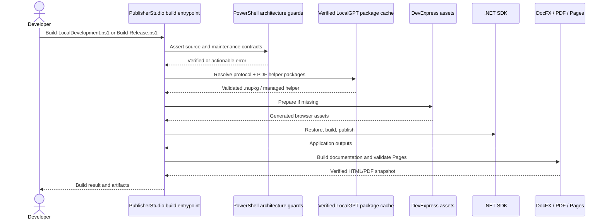
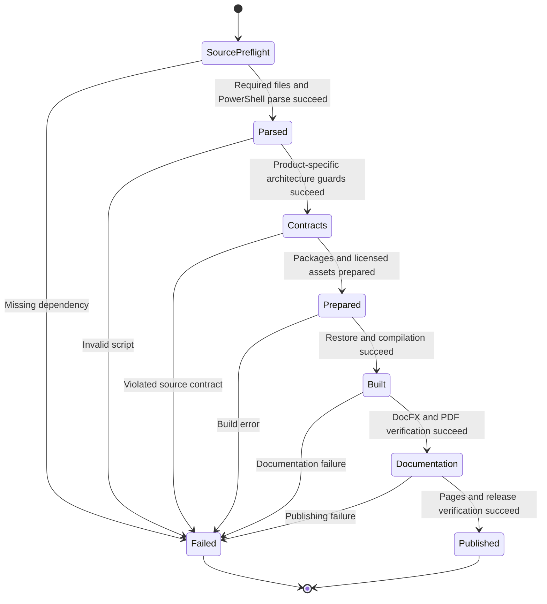

# PowerShell-only maintenance and publishing architecture

PublisherStudio 4.2.0 (rebased directly on 4.1.9) migrates its repository maintenance from Python-driven audits and Pages utilities to a PowerShell-only execution contract. The application retains its own business responsibilities, DevExpress components, PanelStudio persistence/authoring guards, and package/release policies. This is a **build-process** migration, not a merger with LocalGPT's application services.

## Single-command contract

On a supported development host, `Build-LocalDevelopment.ps1` owns prerequisite resolution, generated DevExpress assets, source quality gates, restore/build order, and the documentation output. `Build-Release.ps1` owns third-party notices, platform trust, package resolution, documentation, native packages, and platform-specific publication. Both operations are independently runnable; neither requires manual Python or `dotnet tool install` preparation.

The release PDF merger remains the original LocalGPT-owned `.NET 10` tool (PDFsharp 6.2.4 MIT); PublisherStudio consumes a verified distribution package, not vendored source or a new PDF implementation. The package is unpacked into a repository-local staging area and invoked as `dotnet LocalGPT.ReleasePackaging.dll`, avoiding platform-specific `dotnet tool install` extraction failures. A missing or invalid authoritative package is a verifiable dependency error, not a reason to bypass licensing checks.

## Maintenance gates and process responsibilities

The source guards retain distinct responsibilities: async-only/reactive methods, iterator exception contracts, all service method-local try/catch/logging and lifecycle, component logging/error boundaries, Razor/DevExpress layout, transient state ownership, runtime pattern ownership, PanelStudio interaction/geometry/persistence, XML documentation, and cross-platform host boundaries. These checks are separate from runtime integration tests: source-level PowerShell checks cannot prove DevExpress rendering, model execution, native signing, PDF accessibility, or installer correctness without running the host tools.

## Historical migration

The 132 historical/active Python maintenance files and `build/PythonRuntime.Common.ps1` are no longer distributed. The full list is retained in [maintenance migration history](../maintenance/powershell-migration-history.md). Their actively invoked checks now have maintained PowerShell entrypoints; historical one-off Python work diaries were not recreated as executable release dependencies. The .NET product's Python *code-editing language support* remains unchanged because it is not a build or maintenance interpreter dependency.

All PowerShell scripts are parsed before expensive builds. The resulting validation is structural, **not an executed macOS/Windows build**, until tested on those systems. Do not remove or weaken a guard to make the build green: correct the underlying source or its validator.

## Preserved 4.1.9 behavior

PublisherStudio 4.1.9 already performs automatic, exact-version DevExpress/DevExtreme browser-asset provisioning, maintains the non-design-time MSBuild gate, and enforces stricter native editor/disclosure and geometry-sensitive structural-renderer constraints. The 4.2.0 PowerShell guard retains RAZORUI0015 and the FormLayout/Popup/Grid-to-Stack policies, while the documentation pipeline retains the 4.1.9 repository build-storage and durable landscape PDF chunk cache. Application services, including PanelStudioTextService, are unchanged.
